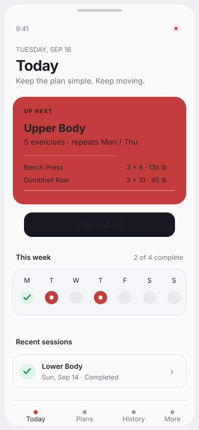
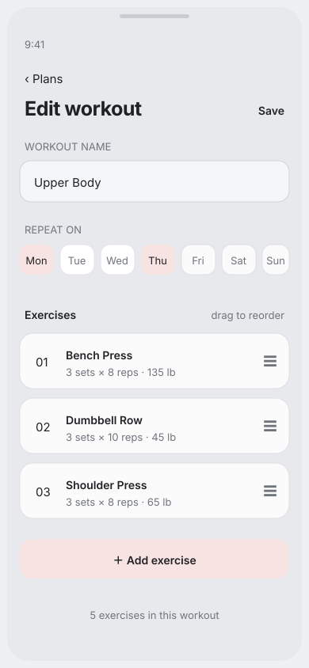
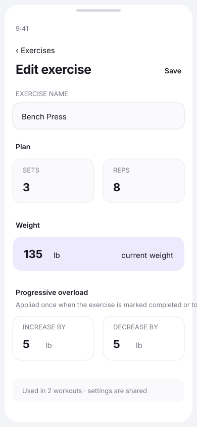
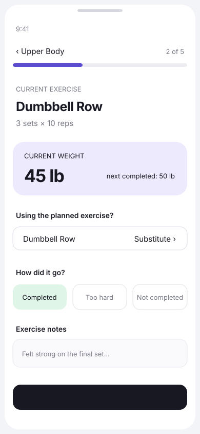
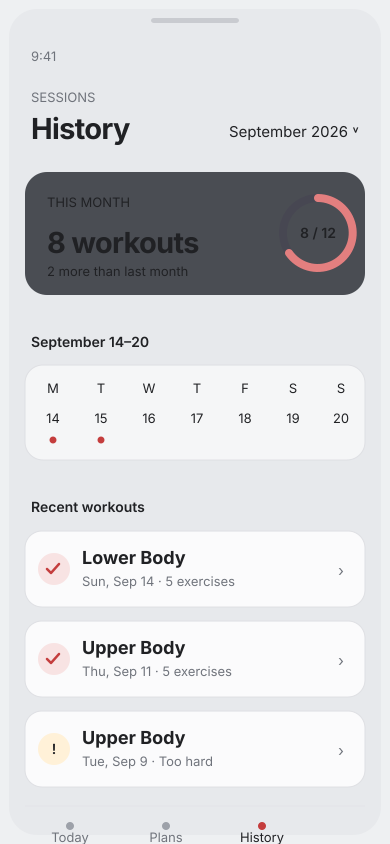

# WorkoutApp UI mockups

This first mockup pass focuses on the agreed local-only MVP:

- Reusable user-created exercises.
- Workouts assigned to one or more weekdays.
- Simple weight progression based on completed, too-hard, or not-completed outcomes.
- Temporary exercise substitutions before a workout starts.
- A persistent calendar and session history.

The screens are intentionally phone-sized and can be viewed directly from the repository on GitHub mobile.

## Today

## Workout editor

## Exercise editor

## Active workout

## History

